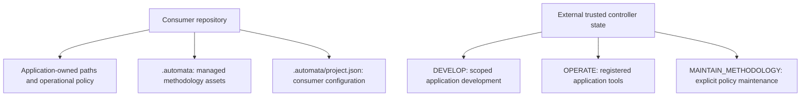

# Ownership and execution contexts

The default `init` layout is isolated as of CLI 0.6. Existing job/journal v1 APIs
remain supported. The old root-copy initializer requires `--layout legacy`.
Adoption profile, execution context and task risk are separate dimensions.



## Installation and migration

```bash
codex-automata init ./new-project --agent codex
codex-automata init ./existing-monorepo --config reviewed-project.json --agent cursor
codex-automata migration ./legacy-project
codex-automata update ./existing-monorepo --staging ./review-candidate
```

Configure project paths explicitly in `.automata/project.json`: source, tests,
specifications, optional SDK, generated files, runtime state, operational entry
points, existing instructions, sensitive/forbidden paths and development ownership.
Every field accepts a list of relative POSIX paths; lists may be empty. Multiple
source/test roots support monorepos. No application directories are fabricated.
`project_root` is `.` relative to the installation's parent; move the installation
with its project. Config is consumer-owned; assets are manifest-owned. Installation
copies assets, not application scaffolding, active hooks or GitHub workflows.

Existing root instructions and Cursor integration are preserved. Review candidates
in `.automata/adapters/` and merge the short routing adapter manually. A new root
AGENTS.md is created only if absent. No development doctrine is always active.
Cursor adapters are candidates, never automatically activated. Application hooks
must compose with the context evaluator; do not replace fail-closed runtime hooks.

Update stages a new candidate, preserves project configuration and reports modified
managed files. It replaces no consumer files. Review manifest diffs and local
customizations before replacement. Legacy paths have ambiguous ownership: the
migration report lists them but deletes nothing. After adopting the new layout,
review/remove old development rules from always-on integrations yourself; leaving
them active defeats functional instruction isolation. Rollback restores the prior
versioned namespace and routing adapter; do not delete application directories.
Installation prepares assets in a temporary directory and removes it on failure.

## Controller bootstrap and context authority

The CLI does not make authority available to an agent automatically. The operator
runs `context bootstrap --state /outside/project/control.sqlite` once and retains
its `authority_token` in an operator-only file outside agent read scope. This
bootstrap command and `context authorize` must never be exposed as model tools.

An authorization JSON has exactly: `id`, `actor`, `task_id`, absolute `repository`,
`context`, `capabilities`, `write_paths`, `policy_version` (`1.0`), `supersedes`
(list of prior grant IDs) and `reason`. It is append-only in trusted state, dated
by the controller. Supersession must refer to the same actor, task and repository.
Tokens for superseded grants cease to work, including already selected contexts.

```bash
codex-automata context bootstrap --state /secure/control.sqlite
# Operator saves authority_token outside agent access, then reviews grant.json.
codex-automata context authorize --state /secure/control.sqlite --authority-file /secure/authority.key --grant grant.json
# Operator saves returned grant/token as /secure/task-grant.json.
codex-automata context select --state /secure/control.sqlite --grant-file /secure/task-grant.json
codex-automata context show --state /secure/control.sqlite --project ./project --task LOCAL-1 --actor coder
codex-automata context check --state /secure/control.sqlite --project ./project --task LOCAL-1 --actor coder --capability file:write --path packages/api/main.py
```

Selection records previous/requested context, actor/task, grant, effective capability
intersection, policy version and configuration/manifest digests. Missing context
fails closed. Policy changes invalidate active contexts. Only a separately issued
maintenance grant permits writes under `.automata/`. DEVELOP file writes require
both configured development ownership and task-granted paths. Forbidden paths
always deny; sensitive paths require `sensitive:access`; runtime state is excluded
from development writes. OPERATE forbids source writes even if a mistaken grant
lists `file:write`. Operational mutations belong to registered application tools.

For standalone development, the operator configures `allowed` paths and checks,
grants DEVELOP, then the coding agent uses workflow context and plan-bound checks.
For application operation, grant only e.g. `mcp:application:web_run` and OPERATE;
load the application's operational instructions, without PLAYBOOK or phase rules.
No transition occurs merely because `.automata/` exists or a prompt says DEVELOP.

## Hooks and trust limits

`context selftest ... --payload event.json` evaluates synthetic hook payloads
without running tools. Supported contract: `tool_name` Read/Write/Edit plus
`input.path` or `input.filePath`; MCP uses `tool_name: MCP:<exact-tool>` and a
separate `mcp_server_name`, mapped to `mcp:<server>:<tool>`. Unknown tools and
unrestricted shells deny with a bootstrap remedy. This contract is tested; verify
the host's actual event schema before installing an adapter. Host-specific hooks
are not universally interchangeable. Re-evaluate every call; never cache a grant
across policy changes. Use `ContextController.evaluate` at the actual tool adapter
boundary before side effects; a selftest or prompt alone does not intercept tools.

The control DB and authority secret require OS/runtime isolation. A process that
can alter the database, read the authority secret, or execute unrestricted shell
commands can bypass these controls. CLI commands are trusted operator interfaces,
not a sandbox. For hosts without reliable pre-action interception, enforce at a
separate tool service/process boundary. No generic hook is silently installed.

Commit `.automata` assets/config/manifest and reviewed routing adapters. Keep control
state, tokens and per-agent checkpoints outside the worktree and model write
scope, retained for the task/audit lifecycle by the operator. Application runtime
state remains at application-configured paths with its own retention policy.

The namespace includes scoped Git attributes preserving managed asset bytes across
Windows/Unix checkouts. Manifest integrity is byte-based; do not normalize managed
files independently of a reviewed update. Consumer-owned project configuration
and routing adapters remain ordinary project files.
